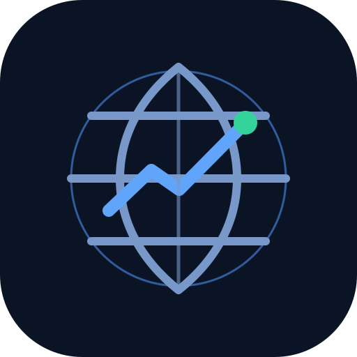

<div align="center">
  

  <h1>Atlas Simulation Studio</h1>

  <p><strong>Una PWA con un diseño profesional, basada en la simulación original de la carrera de población.</strong></p>

  <p>
  
  
  
  
  
  
  
  </p>

  <p>
    <a href="../README.md">English</a> ·
    <a href="README.ru.md">Русский</a> ·
    <strong>Español</strong> ·
    <a href="README.de.md">Deutsch</a> ·
    <a href="README.fr.md">Français</a> ·
    <a href="README.uk.md">Українська</a> ·
    <a href="README.zh-CN.md">简体中文</a>
  </p>
</div>

Atlas Simulation Studio es una aplicación web progresiva con un diseño profesional, basada en la simulación original de la carrera de población. El catálogo inicial incluye **150 países** y **244 ciudades**, además de una línea temporal, gráficos y un editor. El panel **Participantes** filtra países y ciudades por país, continente, subregión, organización internacional y población. Se puede activar a todos, desactivar a todos, dejar solo las coincidencias, añadirlas o excluirlas. Las listas de participantes seleccionados se guardan por separado para países y ciudades en el dispositivo. Cambie el nombre del proyecto, elija el tema de la simulación en la barra superior o en Ajustes y, a continuación, configure la métrica de la carrera.

## ✨ Funciones

- Catálogo inicial de 150 países y 244 ciudades
- Línea temporal y gráficos, más un editor de datos para países y ciudades
- Panel **Participantes**: filtros por país, continente, subregión, organización internacional y población
- Acciones de filtro: activar todos, desactivar todos, dejar solo las coincidencias, añadir coincidencias o excluirlas
- Preajuste de población para ciudades de menos de 1 millón de habitantes
- Las listas de países y ciudades seleccionados se guardan por separado en el dispositivo
- Nombre de proyecto, tema de simulación y métrica de la carrera personalizables
- Modos opcionales de PIB, producción, migración y delincuencia (véase [Precisión de la simulación](#precisión-de-la-simulación))
- Pestañas de carrera y de editor para países y para ciudades
- Controles de reproducción: reproducir / pausa, reiniciar al inicio, y velocidades de 15, 10 o 5 segundos por año
- Herramientas del editor: poner la población a cero, añadir una fila, suavizar saltos bruscos, añadir 10 años, aplicar los datos y eliminar una fila
- 35 idiomas de interfaz, con nombres de países y continentes localizados
- PWA instalable: un service worker almacena en caché la envoltura de la aplicación para siguientes arranques
- Se conserva el ancho original de la visualización y del editor; la altura de la ventana se adapta al dispositivo

## 📦 Descargar e instalar

Hay instaladores **EXE** y **APK** independientes para Windows y Android. Puede descargarlos en [GitHub Releases](https://github.com/DanyaDanileckiy/atlas-simulation-studio/releases) o desde los archivos del repositorio enlazados más abajo. Las instrucciones de instalación también están en [`installer-output/README.md`](../installer-output/README.md).

| Plataforma | Paquete | Requisitos y notas |
| --- | --- | --- |
| Windows | [AtlasSimulationStudioSetup.exe](../installer-output/AtlasSimulationStudioSetup.exe) | PC con Windows. Véanse los pasos siguientes. |
| Android | [Atlas-Simulation-Studio.apk](../installer-output/Atlas-Simulation-Studio.apk) | Android 6.0 o posterior. El APK está firmado; la clave de firma y la contraseña se guardan solo en local y no se incluyen deliberadamente en este repositorio. |
| iPhone / iPad | PWA a través de Safari | No se ha generado un IPA de iOS. Para distribuirlo harían falta la firma de Apple y una cadena de herramientas de compilación para iOS. |
| Web | PWA en el navegador | Para instalar el sitio con icono y arranque sin conexión, debe publicarse en un alojamiento HTTPS. |

### Windows

1. Descargue [AtlasSimulationStudioSetup.exe](../installer-output/AtlasSimulationStudioSetup.exe) desde [GitHub Releases](https://github.com/DanyaDanileckiy/atlas-simulation-studio/releases) o desde el repositorio.
2. Ejecute el instalador. Coloca la aplicación en `%LOCALAPPDATA%\Programs\Atlas Simulation Studio`, crea accesos directos en el escritorio y en el menú Inicio y abre la aplicación.
3. Windows SmartScreen puede mostrar una advertencia de editor desconocido, porque el EXE no está firmado con un certificado de editor. Haga clic en **Más información** y luego en **Ejecutar de todas formas**.

### Android

1. Descargue [Atlas-Simulation-Studio.apk](../installer-output/Atlas-Simulation-Studio.apk) desde [GitHub Releases](https://github.com/DanyaDanileckiy/atlas-simulation-studio/releases) o desde el repositorio.
2. Instale el APK en un dispositivo o emulador con **Android 6.0** o posterior.

### iPhone / iPad

1. Abra el sitio HTTPS publicado en **Safari**.
2. Pulse **Compartir** y luego **Añadir a pantalla de inicio**.

### Web (PWA)

1. Suba todos los archivos de la carpeta del proyecto a un alojamiento HTTPS (por ejemplo GitHub Pages, Cloudflare Pages, Netlify o un servidor propio).
2. Abra la dirección en Chrome o Edge en un PC o en Android y pulse **Instalar aplicación**, o elija la instalación en el menú del navegador.
3. En iPhone o iPad, use Safari → **Compartir** → **Añadir a pantalla de inicio**, como se indica arriba.

El service worker almacena en caché la envoltura de la aplicación para siguientes arranques. Si se abre el HTML como `file://`, la instalación no está disponible.

## 💻 Ejecutar en local

Abra el sitio a través de un servidor HTTP local. Puede:

- ejecutar `start-local.bat`, o
- ejecutar `python -m http.server 8080` y abrir [http://localhost:8080](http://localhost:8080).

Si abre `index.html` directamente como `file://`, la instalación de la PWA no está disponible.

## 🌍 Idiomas

La aplicación ofrece una elección de **35 idiomas**: ruso, inglés, español, francés, alemán, italiano, portugués, neerlandés, polaco, ucraniano, turco, árabe, chino, japonés, coreano, hindi, bengalí, indonesio, malayo, vietnamita, tailandés, sueco, noruego, danés, finlandés, griego, hebreo, persa, urdu, rumano, húngaro, checo, eslovaco, búlgaro y serbio.

| Ámbito | Cobertura |
| --- | --- |
| Nombres de países y continentes | Se localizan según el idioma seleccionado (los 35) |
| Interfaz de la envoltura del estudio | Traducida por completo al ruso, inglés, español, francés, alemán, ucraniano, chino, japonés y árabe. En los demás idiomas, la envoltura pasa al inglés. |
| Etiquetas de la simulación original y del editor | Siguen en ruso |

## ⚠️ Precisión de la simulación

La población de las ciudades recién añadidas son estimaciones orientativas redondeadas para 2020; los límites de la ciudad y de la aglomeración pueden diferir entre los conjuntos de datos de origen. Las series históricas y las previsiones de las ciudades añadidas recientemente se construyen con un modelo simplificado para la visualización; no constituyen una serie estadística oficial.

Los modos de PIB, producción, migración y delincuencia permiten elegir un objeto y un nombre de proyecto, pero no sustituyen los datos demográficos por estadísticas de esos ámbitos: las series de origen introducidas en el editor siguen siendo demográficas. Para que esos modos den un resultado significativo, habría que ampliar el editor con conjuntos de métricas personalizadas independientes y cargar datos para ellos. Por tanto, los valores de las métricas en competición etiquetados como **índice demo** no deben interpretarse como indicadores reales.

## 📁 Estructura del proyecto

```text
├── index.html                 # Aplicación principal de una sola página
├── icon.svg                   # Icono de la aplicación
├── manifest.webmanifest       # Manifiesto PWA
├── sw.js                      # Service worker
├── start-local.bat            # Ayuda de servidor HTTP local para Windows
├── capacitor.config.json      # Configuración de Capacitor 7
├── package.json
├── desktop/
│   └── main.cjs
├── vendor/
│   ├── d3.v7.min.js           # D3.js v7
│   └── tailwindcss.js         # Tailwind CSS
├── public/                    # Recursos web (icono, aplicación, manifiesto, service worker, vendor)
├── android/                   # Proyecto Android de Capacitor 7
└── installer-output/
    ├── AtlasSimulationStudioSetup.exe
    ├── Atlas-Simulation-Studio.apk
    ├── README.md              # Instrucciones del instalador
    ├── win-installer.cpp
    ├── windows-installer.sed
    ├── windows-payload/
    ├── android-native/
    ├── build-apk.ps1
    └── download-android-tools.ps1
```

## 🛠️ Tecnologías

| Capa | Tecnología |
| --- | --- |
| Aplicación | Una sola página `index.html` |
| Estilos | Tailwind CSS |
| Gráficos y visualización | D3.js v7 |
| Aplicación web sin conexión / instalable | Service worker y manifiesto web (PWA) |
| Android | Capacitor 7 |
| Windows | Instalador EXE (`AtlasSimulationStudioSetup.exe`) |
| Desarrollo local | `start-local.bat` o `python -m http.server 8080` |

La clave de firma del APK y la contraseña se almacenan solo en local y no se incluyen deliberadamente en este repositorio de GitHub.
